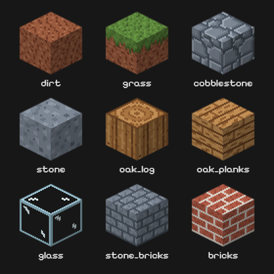

# MC-Clone

MC-Clone is a simple voxel sandbox — a Minecraft-inspired learning project built with TypeScript and Three.js — based on [Midudev's](https://github.com/midudev) video on [YouTube](https://www.youtube.com/watch?v=dm7nfe3bOE4) from the original [freecodecamp's tutorial](https://www.freecodecamp.org/news/code-a-minecraft-clone-using-react-and-three-js/).



## Improvements

- Added TypeScript support
- TailwindCSS for styling
- Added multi-textures blocks
- More blocks
- Block Selection with Hotbar
- Block breaking and placing
- Multi World saving and loading using local storage
- Original textures generated at runtime — no image assets in the repo
- Async texture pipeline with a loading gate (`use()` + Suspense)
- Improved performance and optimization
- Inventory (Comming soon)


## Getting started

Requires Node >= 24 and pnpm.

```bash
pnpm install  # Remember to be aware of minimumAgeRelease policie!
pnpm dev      # dev server, exposed on the LAN
pnpm build    # typecheck + production build
```

## Version history

What changed in each release is in [CHANGELOG.md](CHANGELOG.md).

## Sources

- Original project by [freeCodeCamp](https://github.com/danba340/minecraft-freecodecamp)
- Followed Tutorial from [Midudev](https://github.com/midudev/minecraft-clone)
- [Pixelify Sans](https://github.com/eifetx/Pixelify-Sans) by The Pixelify Sans Project Authors, licensed under the [SIL Open Font License 1.1](https://openfontlicense.org/) and bundled via [Fontsource](https://fontsource.org/fonts/pixelify-sans)

## License

MC-Clone is released under the [MIT License](LICENSE.md) — © 2026 ReinTristan. That covers the code **and** the block artwork, since every texture is pixel art defined in TypeScript (`src/lib/textures/sprites.ts`) and rasterized at runtime, not an image file.

Third-party bits keep their own licenses:

- **Pixelify Sans** — [SIL Open Font License 1.1](https://openfontlicense.org/). It ships as an npm dependency (`@fontsource-variable/pixelify-sans`), so the OFL text travels with the package; a production build embeds the `.woff2` files.

---

Not affiliated with Minecraft, Mojang AB or Microsoft. This is a learning
project: all textures are original artwork generated at runtime, and no
Minecraft assets are redistributed in this repository.
